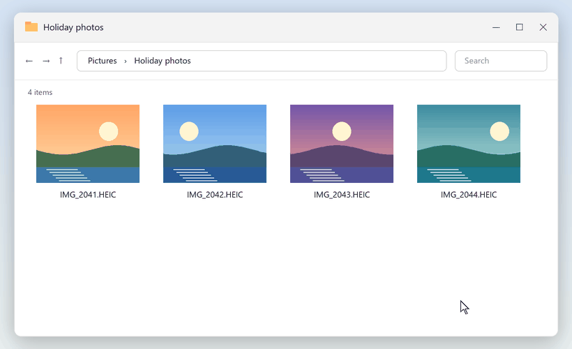
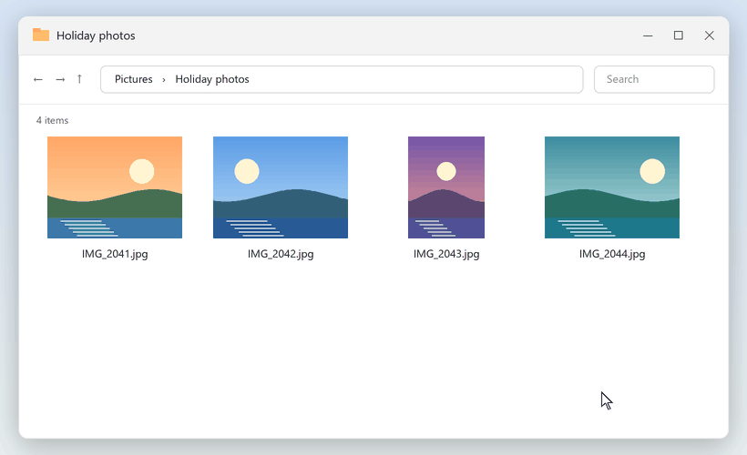
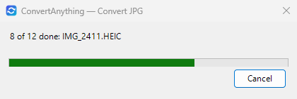

<h1 align="center">Flevert</h1>

<b>Right-click a photo or a PDF, pick what you need, and the result appears next to it.</b> 
iPhone photos to JPG, smaller files, copies without GPS, photos into one PDF. Free, and your files stay on your PC.

- **iPhone photos that open anywhere**: HEIC to JPG, the right way up.
- **Photos that fit**: compress them for chat and email, or to under 500 KB, 1 MB or 5 MB.
- **Seven formats**: convert between JPG, PNG, WebP, AVIF, GIF, BMP and TIFF. Animations stay animated in GIF and WebP.
- **No location in what you share**: remove GPS and camera details first.
- **PDF tools**: photos into one PDF, pages into pictures, merge, split, rotate, compress, add or remove a password; remove blank pages, add page numbers or a watermark, print 2 or 4 pages per sheet.
- **Up to 100 files at once**, with one notification at the end.
- **Originals untouched**: results are saved beside them and never overwrite a file.

## Install

1. Download `Flevert-Setup-<version>.exe` from the [latest release](https://github.com/Suryvibegod/Flevert/releases/latest).
2. Run it (no administrator rights needed). Flevert is not code-signed yet, so Windows says **Windows protected your PC**: [check your download](docs/install.md#check-your-download) if you like, then click **More info** and **Run anyway**. No such button? See [Smart App Control](#smart-app-control).
3. Right-click a picture or a PDF and choose **Flevert**. On Windows 11 it is under **Show more options**, unless you chose the classic menu in setup.

For Windows 10 (1809 or later) and 11, 64-bit.

## The menu

**Pictures** (`.jpg .jpeg .png .webp .heic .heif .avif .gif .bmp .tif .tiff`):

| Flevert > | You get |
|---|---|
| **Convert to** > JPG, PNG, WebP, AVIF, GIF, BMP, TIFF | `photo.jpg`, upright (no GIF for HEIC photos) |
| **Compress** > Light (best quality), Balanced, Strong (smallest) | `photo (compressed).jpg` |
| **Compress** > Under 500 KB, 1 MB, 5 MB | `photo (under 1 MB).jpg`, the best quality that fits |
| **Remove hidden info** | `photo (no metadata).jpg`, without GPS location, camera details, XMP or comments |
| **Combine into PDF** | `photo (+3).pdf`: a page per picture, in name order, without GPS or camera details |

**PDFs**:

| Flevert > | You get |
|---|---|
| **Compress** > Smaller, same quality | `report (compressed).pdf`, smaller with the same quality; also rewrites a slightly damaged PDF so that it opens |
| **Compress** > Smallest, for sharing | `report (small).pdf`: pictures above 150 DPI brought down to 150 DPI, often a quarter to a half of the size, depending on the scan |
| **Merge PDFs** | `report (merged).pdf`, in name order |
| **Split into pages** | a folder `report (split)` with one PDF per page |
| **Convert to** > JPG images, PNG images | a folder `report (pages)` with `report 001.jpg`, … |
| **Convert to** > Text | `report.txt`, the text of every page (scans have none: Flevert does not recognise text in pictures) |
| **Rotate** > Right 90°, Left 90°, 180° | `report (rotated).pdf` |
| **Protect with password**, **Remove password** | `report (protected).pdf` (AES-256), `report (unlocked).pdf` |
| **Remove hidden info** | `report (no metadata).pdf`, without author, dates, XMP, attachments or scripts |

PDFs also have a second entry, **Flevert PDF tools**:

| Flevert PDF tools > | You get |
|---|---|
| **Remove blank pages** | `report (no blank pages).pdf`, without the empty pages a two-sided scan leaves |
| **Add page numbers** | `report (numbered).pdf`, numbered "1 / 12" at the bottom centre |
| **Add watermark…** | `report (watermarked).pdf` with your text across every page, such as what the copy is for; it asks for the text once for all the PDFs you selected. Anyone with a PDF editor can still remove it. The font goes into the PDF and adds about 1 MB to the file. To mark a photo, use **Combine into PDF** first |
| **Print layout** > 2 pages per sheet, 4 pages per sheet | `report (2 per sheet).pdf` or `report (4 per sheet).pdf` on A4, to print on less paper. Made for printing: bookmarks, links and fillable fields are not kept |
| **Fit pages to A4** | `report (A4).pdf`: Letter, A3 and odd sizes scaled to A4. Like Print layout, made for printing: bookmarks, links and fillable fields are not kept |
| **Lock filled forms** | `report (flattened).pdf`: the answers of a filled form, and comments, become part of the page, so nobody can change them |
| **Split by size** > Under 10 MB, Under 25 MB | a folder `report (parts)` with `report part 1.pdf`, …, in page order. **Under 10 MB** is the safe size for email (Gmail counts 25 MB after encoding, about 18 MB of file; Outlook takes 20 MB); **Under 25 MB** is for chat apps |
| **Extract images** | a folder `report (images)` with `report 001.jpg`, `report 002.png`, …: photos exactly as they are in the PDF, other pictures as PNG |

PDFs are read in a separate process with a memory limit, so a damaged or hostile file fails on its own. If Flevert had to repair a PDF to read it, the notification says so: check that the pages look right; a signed PDF's signature is not valid in what Flevert writes, and the notification says that too. A batch that takes more than two seconds shows a progress window with **Cancel**.

## Privacy

No account, no telemetry, no uploads. At most once a day, after a conversion, Flevert asks GitHub whether a new version is out (GitHub sees your IP address and Flevert version) but never downloads or installs anything by itself; turn this off in setup or with `flevert.exe update-check off`.

## Coming next

**1.3**: video and audio. Ideas are welcome in [issues](https://github.com/Suryvibegod/Flevert/issues); changes are in the [CHANGELOG](CHANGELOG.md).

## Troubleshooting

### Smart App Control

With Smart App Control on, Windows 11 may block Flevert with no **Run anyway** button. **Keep it on**: turning it back on can mean resetting Windows. If Flevert got installed, uninstall it ([by hand](docs/install.md#remove-flevert-by-hand) if that is blocked too) and [watch the releases](https://github.com/Suryvibegod/Flevert/releases) for a signed one. On a work or school PC, a policy can also block setup: ask your IT department. If Smart App Control is off and setup still says Flevert stopped, [open an issue](https://github.com/Suryvibegod/Flevert/issues/new/choose) with its message.

### If the menu is missing

On Windows 11 it is under **Show more options** (Shift+F10), and Explorer shows it for at most 100 selected files. If setup reported a problem, run it again; if the problem comes back, [open an issue](https://github.com/Suryvibegod/Flevert/issues/new/choose) with its message. [Logs and other causes](docs/install.md#if-the-menu-is-missing).

### Setup refused the install folder

Setup installs only into `%LOCALAPPDATA%\Programs\Flevert`, and only if no other Windows account can change it: otherwise their code could run as you. If Flevert is already installed there, do not use its uninstaller: [remove it by hand](docs/install.md#remove-flevert-by-hand). [Causes and fixes](docs/install.md#setup-refused-the-install-folder).

### Uninstall

**Settings > Apps > Installed apps > Flevert > Uninstall** removes the program, its menu, logs and settings, and the classic menu if setup turned it on. Your converted files stay.

## Contributing and license

Bug reports, ideas and pull requests are welcome: see [CONTRIBUTING.md](CONTRIBUTING.md), or [SECURITY.md](SECURITY.md) for security problems. [MIT license](LICENSE); bundled components' licences are in `THIRD-PARTY-NOTICES.txt` in the install folder.
